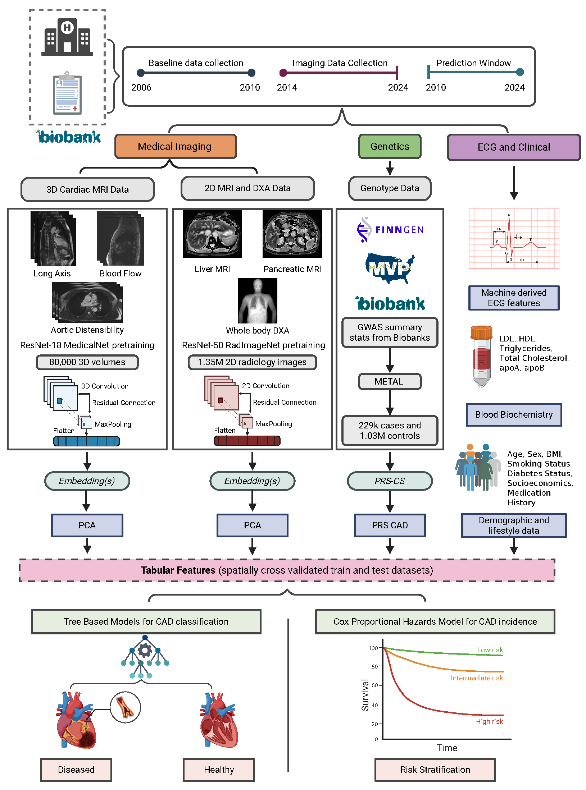
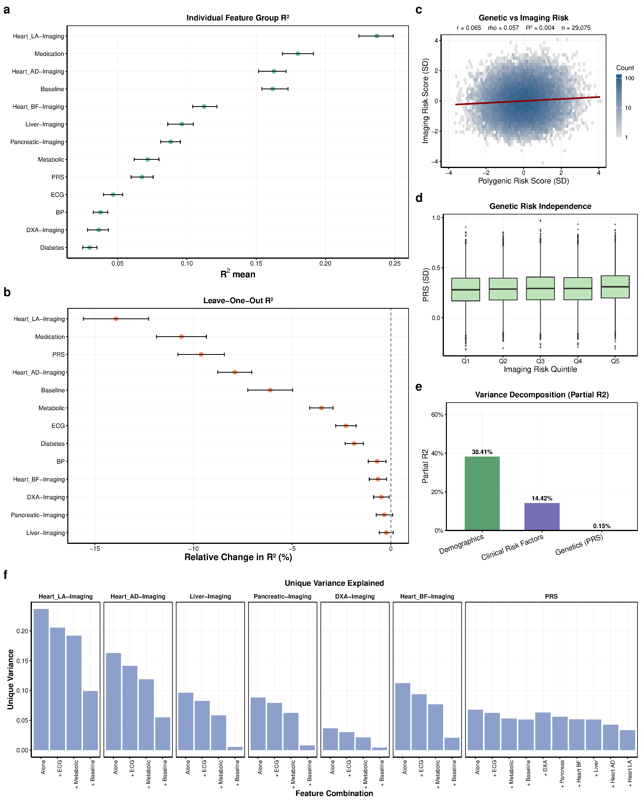

# Multimodal integration reveals complementary imaging and genetic axes of coronary artery disease risk

A deep-learning framework that integrates **multi-organ medical imaging, polygenic risk, ECG, and clinical biomarkers** to predict 10-year incident coronary artery disease (CAD) in the UK Biobank — and to disentangle the *complementary* and *independent* contributions of imaging-derived and genetic risk.

This repository contains the **analysis and figure-generation code** for the manuscript below.

> **Multimodal AI for Precision Preventive Cardiology**
> Devansh Pandey, Liaoyi Xu, Eucharist Kun, Chenfei Li, Joyce Y. Wang, Alaa Melek, Julie C. DiCarlo, Edward Castillo, Jagat Narula, Charles A. Taylor, Vagheesh M. Narasimhan
> *medRxiv* 2025.10.09.25337677 · doi: [10.1101/2025.10.09.25337677](https://doi.org/10.1101/2025.10.09.25337677)

> [!IMPORTANT]
> **This repository contains code only.** No individual-level UK Biobank data, imaging, polygenic scores, or trained model weights are included. See [Data availability](#data-availability).

---

## Overview

Coronary artery disease remains the leading cause of death worldwide, yet imaging and genetics — two of the most informative risk axes — have largely been developed in parallel. We built a unified multimodal framework to ask three questions:

1. **Which imaging modalities** carry non-redundant predictive information once clinical and genetic risk are accounted for?
2. **Are imaging-derived and genetic risk independent** biological dimensions of disease?
3. **Does sequential integration** of clinical, genetic, and imaging data improve risk stratification beyond conventional scores?

Imaging is encoded with deep convolutional models, compressed to low-dimensional embeddings, and fused with a polygenic risk score (PRS), ECG features, and clinical variables in time-to-event models, with leave-one-centre-out spatial cross-validation.



### Data modalities

- Cardiac MRI — 3D long-axis cine, aortic distensibility, and blood flow
- Liver and pancreas MRI
- Whole-body DXA
- 12-lead ECG
- Blood biochemistry and lipid biomarkers
- Polygenic risk score (PRS)
- Demographic and clinical variables

### Key findings

- **Cardiac imaging dominates.** Among all imaging modalities, only **long-axis cardiac MRI and aortic distensibility** retained substantial independent predictive value. Liver, pancreas, blood-flow MRI, and DXA contributed little once baseline factors (age, sex, BMI, smoking) were adjusted for — revealing extensive redundancy across imaging.
- **Imaging and genetic risk are complementary.** PRS showed minimal correlation with imaging-derived risk (genetics explained <1% of imaging-score variance) yet, despite being a modest standalone predictor, retained significant independent value in the full multimodal model.
- **Learned embeddings ≥ handcrafted phenotypes.** PCA-reduced deep embeddings outperformed conventional imaging-derived phenotypes (AUC 0.79 vs 0.67) while remaining compact and scalable.
- **Multimodal stratification.** Sequentially layering clinical → genetic → imaging risk identified a subgroup with a **~15.8-fold** increase in 10-year incident CAD relative to the Framingham Risk Score baseline, also exceeding the PREVENT equations.



---

## Repository structure

```
.
├── Data Processing/        DICOM handling and per-modality image preprocessing
│                           (cardiac, aortic, liver, pancreas), ECG and clinical prep
├── Training/               Per-modality deep models
│                           - MONAI / 3D-ResNet (cardiac, aortic, blood-flow MRI)
│                           - RadImageNet 2D-ResNet (liver, pancreas, DXA)
├── Embedding_Extraction/   Latent embedding extraction per modality + Grad-CAM interpretability
├── Modelling and Analysis/ Multimodal fusion, Cox survival models, embeddings vs IDPs,
│                           and the imaging risk score (IRS) methodology
├── PRS/                    GWAS summary-stat harmonization, METAL meta-analysis, PRS-CS
├── Scripts/                Main-figure generation (Figure 2–5)
│   └── revised_figures/    Updated figure scripts (manuscript revision)
├── Models/                 Notes on trained model weights (available on request)
└── assets/                 Workflow diagram, key figures, Grad-CAM panels
```

## Methods pipeline

| Stage | What it does |
|-------|--------------|
| **Imaging models** | 3D convolutional networks (MONAI / MedicalNet) for long-axis cardiac, aortic distensibility, and blood-flow MRI; 2D ResNet-50 (RadImageNet) for liver, pancreas, and DXA. |
| **Embeddings** | Latent features extracted from the final pooling layers, reduced to compact representations by PCA; benchmarked against expert imaging-derived phenotypes (IDPs) via canonical correlation analysis. |
| **Genetics** | CAD GWAS meta-analysis across the non-imaged UK Biobank, FinnGen, Million Veteran Program, and Biobank Japan (METAL), with genome-wide polygenic scores derived using **PRS-CS**. Imaged participants are excluded from discovery to prevent sample overlap. |
| **Multimodal integration** | Late-fusion tree-based classifiers and Cox proportional-hazards models combining imaging PCs, PRS, ECG, lipids, and demographics. |
| **Validation** | Leave-one-centre-out spatial cross-validation across the four UK Biobank imaging centres (Bristol, Cheadle, Newcastle, Reading). |

---

## Data availability

Individual-level UK Biobank data **cannot be redistributed** under the UK Biobank Material Transfer Agreement. Approved researchers can access the data through the UK Biobank [application process](https://www.ukbiobank.ac.uk/enable-your-research/apply-for-access). This work was conducted under UK Biobank application number **65439**.

Trained model weights are available from the authors on reasonable request.

## Requirements

- **Python** — PyTorch, MONAI, scikit-learn, pandas, numpy, lifelines, xgboost
- **R** — survival, ggplot2, dplyr, patchwork, gridExtra
- **Genetics tooling** — REGENIE, PLINK 2.0, PRS-CS, METAL

Notebooks are provided with outputs cleared; scripts reference data by path and contain no participant-level data.

## Citation

```bibtex
@article{pandey2025multimodal,
  title   = {Multimodal AI for Precision Preventive Cardiology},
  author  = {Pandey, Devansh and Xu, Liaoyi and Kun, Eucharist and Li, Chenfei and
             Wang, Joyce Y. and Melek, Alaa and DiCarlo, Julie C. and Castillo, Edward and
             Narula, Jagat and Taylor, Charles A. and Narasimhan, Vagheesh M.},
  journal = {medRxiv},
  year    = {2025},
  doi     = {10.1101/2025.10.09.25337677}
}
```

## Contact

Correspondence: **Vagheesh M. Narasimhan** — The University of Texas at Austin.
Code and analysis: Devansh Pandey.
